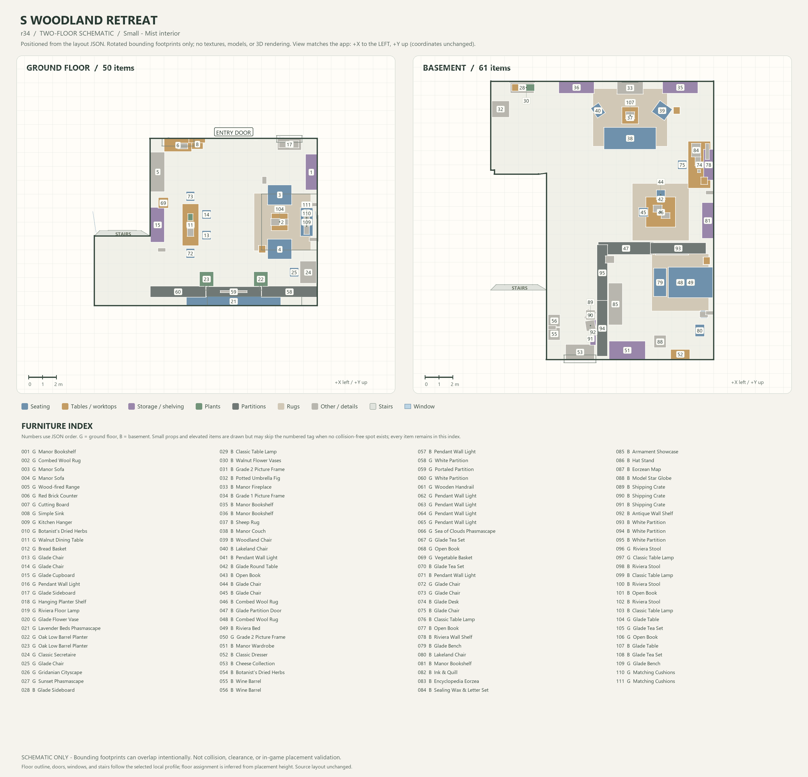
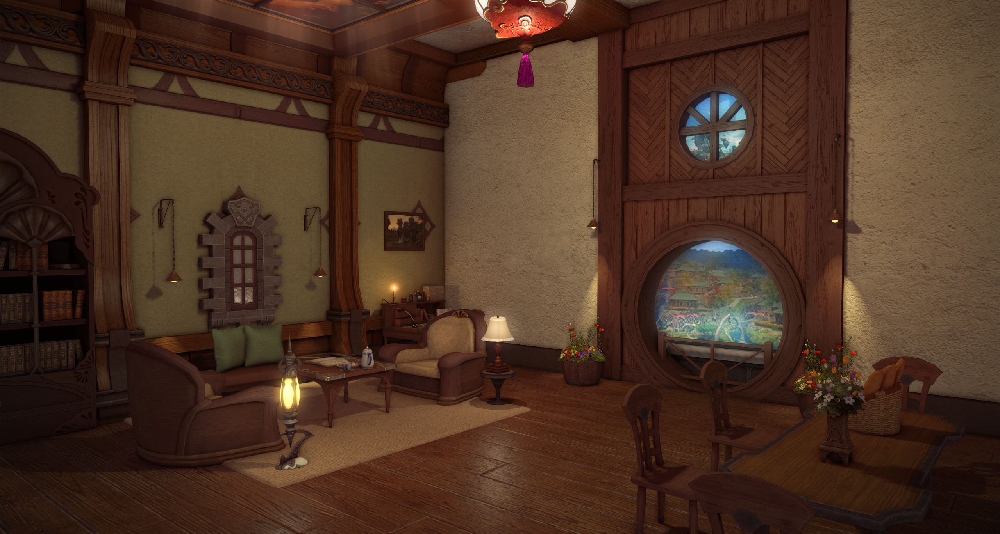
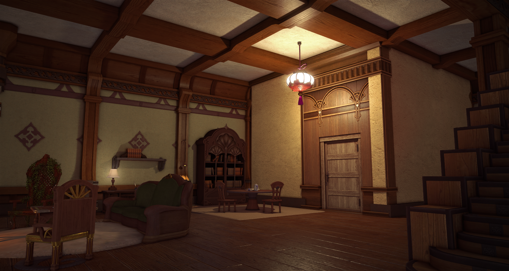
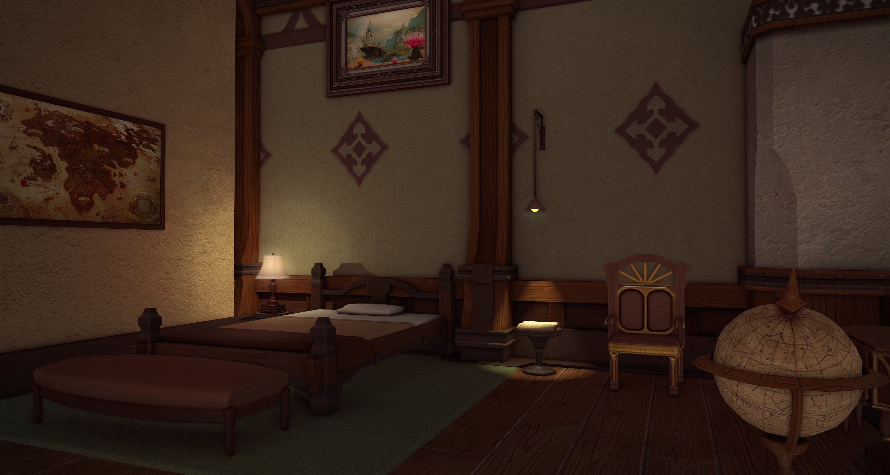
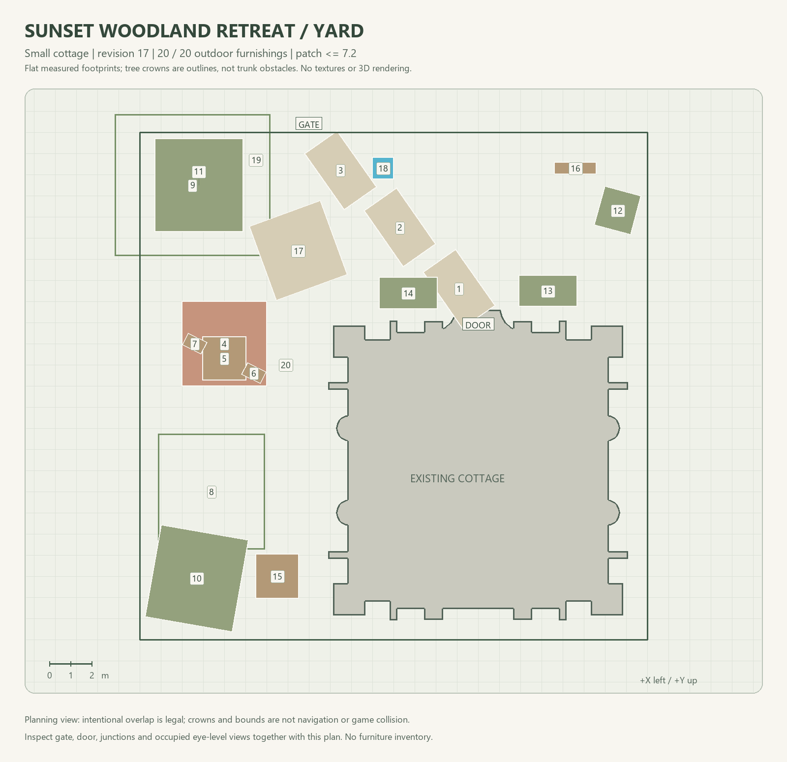
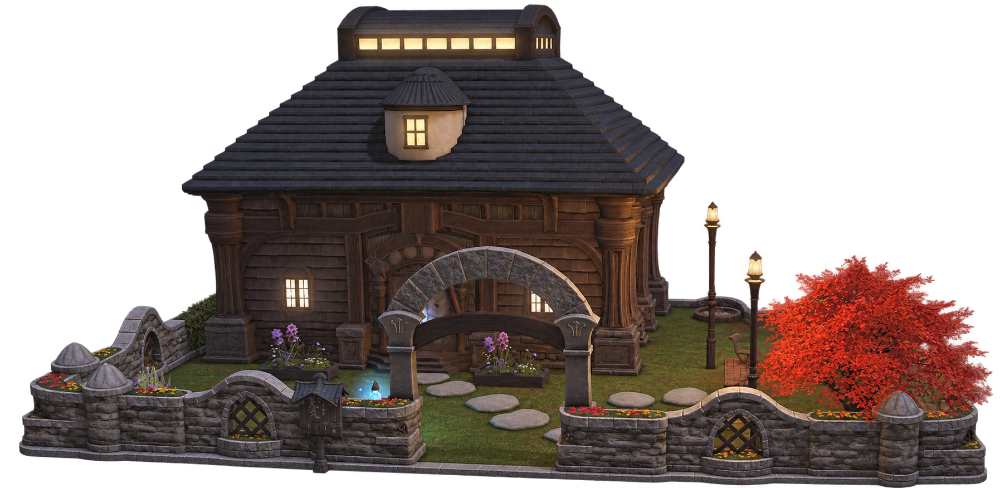

# FFXIVFurn

A Python/SQLite furniture catalog and tools for editing, previewing, and exporting ReMakePlace layouts through MCP. Interiors and yards use separate sessions. The MCP server does not run an LLM; your client supplies the model.

> **Code and documentation only; no database or game assets are included.** Do not distribute databases, extracted meshes/textures/thumbnails, model caches, or local outputs in this project's releases, attachments, or packages. Those materials belong to their respective rights holders; see the [distribution policy](docs/distribution.md). Native previews are not game or app screenshots.

## Where to start

| Task | Prerequisites | Documentation |
|---|---|---|
| CRUD, tags, text search | Python; a new empty database is sufficient | Quick start below, [Catalog API](docs/catalog.md) |
| Semantic search | Your own descriptions and optional dependencies | [Catalog API](docs/catalog.md) |
| Interior/yard MCP | Complete local catalog, assets, layout seed, OpenGL | [MCP guide](docs/mcp.md) |
| Layout rendering | Same as above; no LLM required | [Renderer](ffxiv_furniture/rendering/README.md) |
| Image classification/vocabulary | Your own image manifest and model endpoint | [Classification](ffxiv_furniture/classification/README.md) |
| Interior and yard design method | No tools required; a reference for the model or user when planning or revising a layout | [Design method](DESIGN_CONTEXT.md) |
| Development and script selection | Distinguish supported entry points from historical scripts | [Code guide](WORKSPACE.md) |

**A fresh clone can run empty-database CRUD, but cannot render immediately.** `init` does not create a complete furniture catalog, geometry, house materials, or support surfaces. Data is not available as a separate release download. Follow the [local bootstrap guide](docs/bootstrap.md) with your own assets and English game CSVs. Private classification history is not required; visual tags and vectors are not generated automatically.

## Installation

Python 3.12 is recommended. CRUD uses only the standard library; install other dependencies as needed. All three requirements files have been installed in a fresh Windows Python 3.12 venv and verified with dependency checks, GPU tests, and real MCP calls. Local data is still required. See [development status](docs/development.md). Run from the project root; these examples use **Windows Git Bash**:

```bash
# Create only if .venv does not exist; do not overwrite an existing environment.
python -m venv .venv
PY=.venv/Scripts/python.exe
"$PY" -m ffxiv_furniture --help

# Required only for MCP/GPU rendering.
"$PY" -m pip install -r requirements-render.txt
# Required only for semantic search; the first use downloads a model.
# "$PY" -m pip install -r requirements-semantic.txt
# Required only for classification.
# "$PY" -m pip install -r requirements-classification.txt
```

In PowerShell, use `.\.venv\Scripts\python.exe`; see the [MCP guide](docs/mcp.md) for environment variables. Linux/macOS typically use `.venv/bin/python`. The Python MCP client uses the interpreter that launched it, but Linux/macOS have not been verified on real systems.

## Quick start: no game assets required

Write only to a test database, not the production database. Adding the same ID twice fails; choose a new test database filename when repeating the example.

```bash
PY=.venv/Scripts/python.exe
DB=data/quickstart.sqlite3
"$PY" -m ffxiv_furniture --db "$DB" init
"$PY" -m ffxiv_furniture --db "$DB" furniture-add --id 28639 --name "Leather Sofa" --description "A dark leather sofa" --scope interior
"$PY" -m ffxiv_furniture --db "$DB" search --query "sofa"
"$PY" -m ffxiv_furniture --db "$DB" furniture-get 28639
```

Place `--db` before the subcommand. Omitting it selects `data/furniture.sqlite3`; **always specify a test database explicitly for trial writes**. Image paths are recorded only; images are not downloaded automatically. See the [Catalog API](docs/catalog.md) for more CLI and Python examples.

## Build your own local catalog

Prepare assets and source settings using the [bootstrap guide](docs/bootstrap.md). The output database must not exist; do not run init on it first:

```bash
"$PY" -m ffxiv_furniture.bootstrap --sources data/local-sources.json --output data/local/catalog.sqlite3 --workers 6
export FFXIVFURN_SOURCES="$PWD/data/local-sources.json"
export FFXIVFURN_DB="$PWD/data/local/catalog.sqlite3"
```

Identified items whose geometry cannot be parsed are recorded explicitly, not presented as renderable furniture. Patch values remain unknown without a reliable source. See the guide for coverage and limitations.

## Setup checks (read-only; no downloads or model calls)

```bash
# Basic catalog checks.
"$PY" -m ffxiv_furniture.doctor
# Requires complete local data; also tests a real OpenGL context.
"$PY" -m ffxiv_furniture.doctor --render --gpu --seed data/my-layout.json
```

Missing data or schema produces a nonzero exit status. The command does not manufacture databases, assets, or vectors.

## Decorating and rendering

Once data is ready, configure a session and seed using the [MCP guide](docs/mcp.md). Keep one persistent connection per design, with separate names for interior and yard sessions. Registration in a particular agent application is not required.

- Interiors: Small (ground floor and basement), Medium (ground and upper floors), Apartment (single floor). Large interior MCP is unsupported; Medium basements are not fully supported.
- Yards: S/M/L; outdoor furniture, exterior walls, roofs, fences, doors/windows, roof/wall decorations, and placards. Select styles with `search_materials`/`set_exterior`.
- Start with `status`/`inspect`. After editing, render and inspect the image before continuing. Numerical diagnostics are not aesthetic scores or proof of game collision behavior.
- Normal renders save only PNGs in one `renders/` directory, with revisions distinguished by filename. JSON diagnostics require explicit opt-in. Session state, snapshots, and exports are unaffected.
- OpenGL 3.3 is required; there is no CPU fallback. Glass is an approximate translucent pane and emission is per material slot; water/particles, reflections and game shadows are not rendered (use ReMakePlace for lighting); finishes are not guaranteed complete for every house type. Export success is not app-import acceptance.
- Parsed meshes and material instances are memoised per server process (keyed by file size/mtime), so only the first render of a session pays the decode cost.

## Example

### Small-house interior

One Small-house interior produced from a single design brief, then checked in the game. The brief ([examples/prompt.md](examples/prompt.md)) asks for an original "Sunset Woodland Retreat": a warm, rustic countryside cottage with a reading/lounge area, a study corner, and a window-alcove focal point. It sets the style, palette, zoning, lighting, originality and evaluation requirements, and requires furniture to come only from the catalog.

The example was produced by Claude Opus 5.5 driving the MCP tools (`inspect`, edit, `render`, and review) over several tweak rounds with human feedback, following the workflow in [DESIGN_CONTEXT.md](DESIGN_CONTEXT.md) (activity brief, shell survey, zoning, furniture binding, lighting, then render-and-revise). DESIGN_CONTEXT.md is a methodological reference, not a description of what the tools implement.

**Flat layout schematic** (generated by `python scripts/layout_schematic.py <layout.json>`; footprints only, not game art):



**In-game result** (screenshots taken by the maintainer in FFXIV):

| View 1 | View 2 | View 3 |
|---|---|---|
|  |  |  |

The in-game screenshots are the maintainer's own captures. They show game assets, so confirm you are comfortable publishing them (see the [distribution policy](docs/distribution.md)). Do not add databases or extracted meshes/textures.

### Small-house yard

A 20-furnishing yard extension of the same "Sunset Woodland Retreat", retaining the private Aetheryte, tea seating and clear entrance routes. The [yard adaptation brief](examples/yard-prompt.md) summarizes the requirements and later feedback; the final simplification reuses only existing furnishings, with no new types or extra copies.

The yard was developed with GPT-6.1 (Sol) driving the MCP tools over several refinement rounds with human feedback, following [DESIGN_CONTEXT.md](DESIGN_CONTEXT.md). Flat plans were used during planning and revision, not only at delivery; the document remains a methodological reference, not a description of implemented tooling.

**Flat yard schematic** (measured footprints of the 20-item layout; no furniture inventory, textures or 3D rendering):



**GPT-edited yard illustration** (based on the maintainer's FFXIV screenshot):



**GPT was used to remove the background, but it also redrew the image.** Details may differ from the original in-game screenshot. This is an edited illustration, not an unaltered game screenshot, a ReMakePlace screenshot or native-renderer output; it is not evidence of exact placement or furnishing counts.

The illustration contains game-derived content and is not covered by the code/documentation MIT grant; see the [distribution policy](docs/distribution.md).

## Development and pre-distribution checks

```bash
python -m unittest discover -s tests -p 'test_catalog.py' -q
python -m unittest discover -s tests -p 'test_distribution.py' -q
python scripts/check_distribution.py
# The full suite also requires local data, optional dependencies, and a GPU.
# .venv/Scripts/python.exe -m unittest discover -s tests -q
```

Do not ZIP the entire working directory for a release. `.gitignore` does not untrack existing files or protect manual attachments; see the [distribution guide](docs/distribution.md). Code and original project documentation use the [MIT License](LICENSE). The project does not publish releases automatically or include databases. MIT does not cover databases, game/ReMakePlace assets, model weights, or other third-party content, and grants no distribution rights to them.
